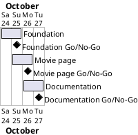

# Project Plan

## Metadata
| Key | Value |
| --- | --- |
| ID | PP-001 |
| CrossReference | [BC-001], [SA-001], [MIL-001], [MIL-002], [MIL-003] |
| Language | en |
| Domain | it |

## Version History
| Date | Status | Author | Reviewer | Change | Commit |
| --- | --- | --- | --- | --- | --- |
| 2026-10-24 | Accepted | Jens Tirsvad Nielsen | AI as stand-in for S01 | Initial version | [e8d24b2] |

---

## Purpose

This plan schedules the three gateways of the HTML-only Favorite Movie project over the Business Case constraint of one week (2026-10-24 to 2026-10-31).

## Planning Assumptions

- Week 1 starts 2026-10-24; the plan ends by 2026-10-31, per [BC-001].
- Phase length: one to two days per gateway, one pull request per milestone.
- S01 is owner and reviewer of every gateway; in autonomous mode the AI is the stand-in reviewer and says so in the review record.
- The project is too small for use-case artifacts; every task is a plain task and cites the Business Case objective it serves.
- The product is HTML only. The Python quality-check workflow is not installed because the repository has no Python or shell files.

## Gateway Schedule

| Gateway | Document | Window | Decision date | Owner | Stories | Main deliverable | Milestone |
| --- | --- | --- | --- | --- | --- | --- | --- |
| Foundation | [MIL-001] | 2026-10-24 to 2026-10-25 | 2026-10-25 | S01 | none | Folder skeleton, workflows, repository metadata | |
| Movie page | [MIL-002] | 2026-10-25 to 2026-10-26 | 2026-10-26 | S01 | none | index.html, styles.css, manual checklist | |
| Documentation | [MIL-003] | 2026-10-26 to 2026-10-27 | 2026-10-27 | S01 | none | README, screenshots, wiki in en, da, ms | |



## Scope Coverage

| Business Case scope item | Gateway |
| --- | --- |
| `src/`, `tests/` and `docs/` folders, `.gitignore` | [MIL-001] |
| Repository description, topics and installed workflows | [MIL-001] |
| The HTML page and its manual checklist | [MIL-002] |
| README with screenshot | [MIL-003] |
| Wiki in en, da and ms with screenshots | [MIL-003] |

## Dependencies

```
MIL-001 -> MIL-002 -> MIL-003
```

A No-Go moves every later date by the time needed to fix the gateway.

## Plan Risks

| Risk | Impact | Mitigation |
| --- | --- | --- |
| Workflow secrets are not yet created on the git host | Workflow runs fail after merge | The README lists the secrets; the failure does not block the milestones |
| Translation effort larger than planned | MIL-003 slips | English is written first; da and ms follow page by page |

## Open Issues

- The runner and the secrets `TOKEN_FOR_GITEA` and `TOKEN_FOR_GITEA_WIKI` of the organisation are S01's to confirm.
- The wiki must be enabled in the repository settings for the publish workflow to work.

---

[BC-001]: ./business-case.md
[SA-001]: ./stakeholder-analysis.md
[MIL-001]: ./milestones/mil-001-foundation.md
[MIL-002]: ./milestones/mil-002-movie-page.md
[MIL-003]: ./milestones/mil-003-documentation.md
[e8d24b2]: https://git.tirsystem.com/Tirsvad-Udemy-100-days-of-code/041-web-movie-ranking/commit/e8d24b2d32ce1ef8276123b0efa05b8a15e27d52
